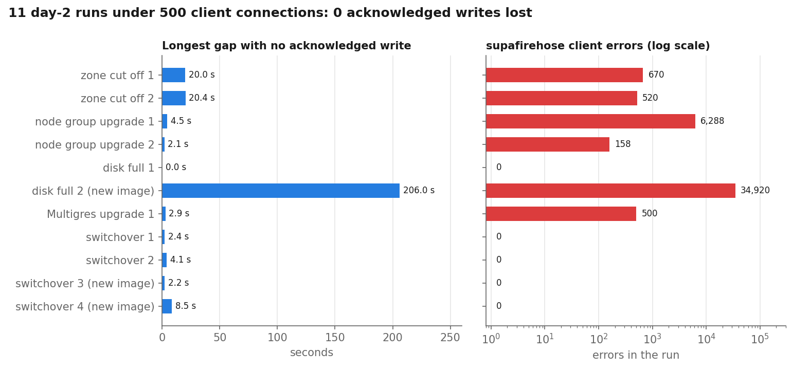
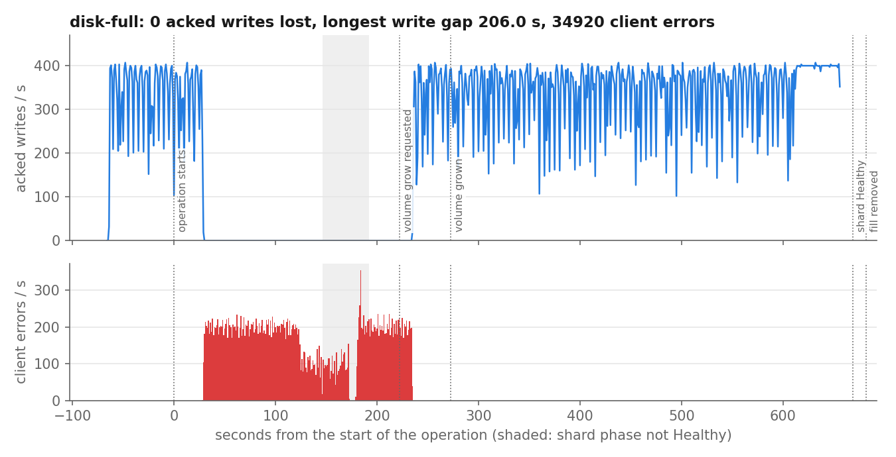
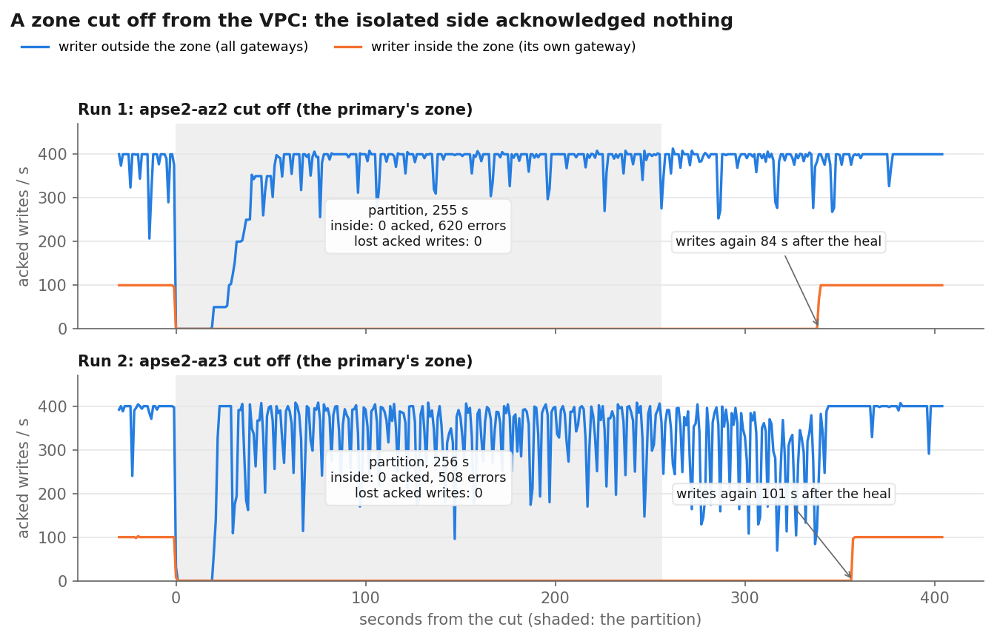
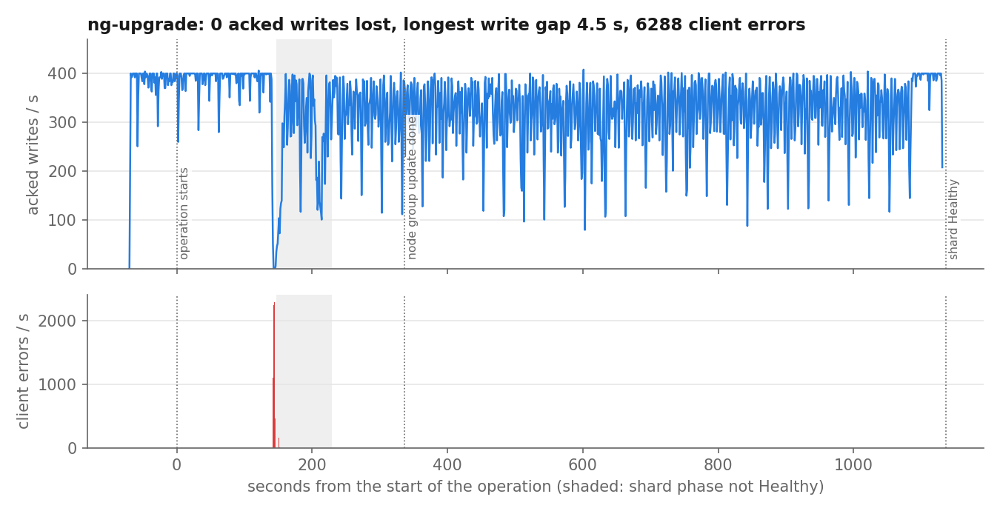
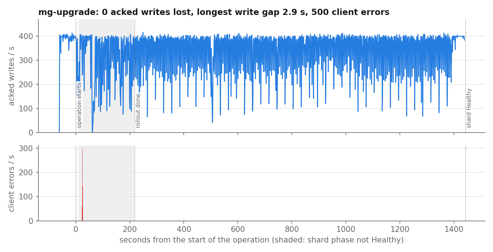
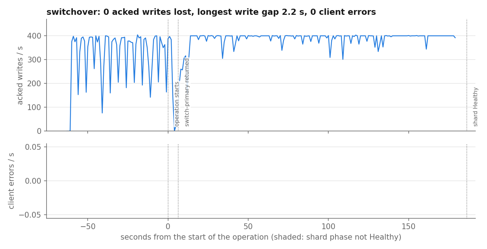

# Day-2 operations on Multigres under load: what clients see

The [failure drills](../failure-drill/failure-drill.md) and the [production scenario](../production-scenario/scenario.md) broke things that shouldn't break: a pod, a node, a zone. This part does the work an operator does on purpose, or that creeps up slowly, while the database is busy:

1. **A zone cut off from the network** while its machines keep running (a network partition, not an outage)
2. **A managed node group upgrade** of the node holding the primary
3. **The primary's volume filling up**, then grown through the `MultigresCluster`
4. **A rolling Multigres upgrade** to newer images
5. **A graceful switchover** with `multigres cluster switch-primary`

Every run had the same load as the production scenario. [supafirehose](https://github.com/multigres/supafirehose) held 500 client connections through the gateways (2,000 reads/s and 200 writes/s in total), and the drill writer from `failure-drill/` recorded every write and checked every acknowledged one afterwards. Same EKS cluster: three zones, one pooler per zone, `MULTI_CELL_AT_LEAST_2`, the gateway buffer at its defaults.

## Summary

| Operation | Runs | Acknowledged writes lost | Longest gap with no acknowledged write | supafirehose client errors | What stood out |
|---|---|---|---|---|---|
| Zone cut off | 2 | **0** | 20.0 s, 20.4 s | 670, 520 | the cut-off side acknowledged **nothing** after its first 67 ms (8 writes already in flight) |
| Node group upgrade | 2 | **0** | 4.5 s, 2.1 s | 6,288, 158 | the same operation, 40 times the client errors in one run |
| Disk full | 2 | **0** | 0 s, **206 s** | 0, 34,920 | every write rejected for 206 s while the Shard, whose phase follows pod readiness, said **Healthy** for most of it |
| Rolling Multigres upgrade | 1 | **0** | 2.9 s | 500 | replacing the gateways drops every client connection once |
| Graceful switchover | 4 | **0** | 2.2–8.5 s | **0** | the gateway retried for the clients, they saw nothing |

**0 of 2,684,205 acknowledged writes lost** across the 11 runs, plus 0 of 38,321 for the second writer inside the cut-off zone. The check re-reads every acknowledged insert after the run. It covers inserts, not reads or updates.

## Findings

| | Finding | Why it matters |
|---|---|---|
| **D1** | With the primary's volume full, every write failed for 206 s. The Shard reported `Healthy` for about 160 s of that, and multiorch raised `LeaderUnhealthy` for 1.1 s, then cleared it | the Shard phase follows pod readiness, and the pods stayed ready. It is not a signal for "can this shard take writes", so a full disk needs its own alert |
| **D2** | Growing the volumes through the `MultigresCluster` worked online, and writes came back 13 s after the change | the fix is safe to apply under load, so the runbook can be short |
| **D3** | A zone cut off from the VPC acknowledged no write after the 8 already in flight (all within 67 ms of the cut), and the other two zones took writes again after 20 s, even when the cut-off zone held 2 of the 3 etcd members | the safety property you want from a partition, measured from both sides |
| **D4** | The two node group upgrades caused 6,288 and 158 client errors. In the first, 5,908 were failed credential lookups from clients reconnecting while there was no primary | client impact of the same AWS operation varies a lot from run to run. In run 1 the new primary landed on `apse2-az1`, the node that also runs the load tool, Auth and Prometheus (see Limits), which may explain part of it. Two runs can't show how much |
| **D5** | A rolling upgrade replaces the gateway pods, and every client connection on an old gateway ends with `unexpected EOF` (500 errors, connections down to 381 of 500 for a few seconds) | applications see one reconnect per client on every gateway rollout, as with any Postgres proxy that is replaced. Plan rollouts for it |
| **D6** | During a graceful switchover the gateways retried the `fenced` errors internally (843–2,472 per run) and clients saw 0 errors | planned moves of the primary are invisible to clients that wait, on both the old and the new image. The drill writer gives up after 2 s, so 8 of its writes per run timed out on its side, and 4 to 7 of those had committed |

### D1. A full disk: every write fails, the status says Healthy

The drill fills the primary's data volume with a file, keeps it full for 3 minutes, then grows all three pool volumes through the `MultigresCluster` storage size, the documented way (10 to 15 Gi in run 1, 15 to 20 Gi in run 2).

The first run left 64 MiB free. Postgres used only 25 MiB of it in 4 minutes, so the disk never actually filled, and nothing happened. The second run left 1 MiB, and the volume hit 0 bytes free within a minute.

The shaded band is the only time the Shard's phase was not `Healthy` (45.6 s). Everything to its left and right, where the writes are at zero and the client errors are at 200 per second, the Shard said `Healthy`.

| Time (UTC) | What happened | Shard phase |
|---|---|---|
| 15:25:16 | the volume is filled, 1 MiB left | Healthy |
| 15:25:46 | the first write fails with `53100 could not extend file … No space left on device` | Healthy |
| 15:27:36 | the primary's pool shows 2 of 3 containers ready | Healthy |
| 15:27:43 | | Progressing |
| 15:28:10 | multiorch raises `LeaderUnhealthy`, and clears it at 15:28:11 | Progressing |
| 15:28:29 | | **Healthy** again, writes still failing |
| 15:28:59 | the volumes are grown to 20 Gi through the `MultigresCluster` | Healthy |
| 15:29:12 | writes succeed again | Healthy |
| 15:29:49 | the PVC reports 20 Gi | Healthy |

What the writer got: 5,326 `53100` errors, 17 `57P03` and about 110 timeouts. The pooler couldn't open its own admin connections ("could not write init file"), so it couldn't report the role or write its heartbeat. Multiorch didn't fail over, and the primary stayed where it was.

**A caveat on the drill.** Only the primary's volume was filled. In real life every member's volume fills at about the same rate, because they hold the same data, so failing over wouldn't have helped much. The point here is detection: nothing in the operator's status or multiorch's view says "this shard can't take writes", so a volume headroom alert (for example `kubelet_volume_stats_available_bytes` on the pool PVCs) is the only early warning.

### D3. A zone cut off from the network

The drill gives the primary's zone subnet a network ACL that allows its own subnet and the internet, and denies the rest of the VPC, both ways. The machines keep running and can't talk to the other two zones. A second writer runs inside the cut-off zone through that zone's own gateway, to see whether the isolated side acknowledges anything. After about 4 minutes the original ACL is put back.

| | Run 1 (apse2-az2 cut off) | Run 2 (apse2-az3 cut off) |
|---|---|---|
| Partition | 255 s | 256 s |
| Detection | `LeaderQuorumWritesStalled`, 22.1 s | `LeaderQuorumWritesStalled`, 21.9 s |
| Longest gap, writer outside the zone | 20.0 s | 20.4 s |
| New primary | apse2-az3 | apse2-az1 |
| Writer inside the zone: writes acknowledged 1 s or more after the cut | **0** | **0** |
| Writer inside the zone: errors during the partition | 620 | 508 |
| Writer inside the zone: writes again after the heal | 84 s | 101 s |
| supafirehose client errors, connections at lowest | 670, 244 of 500 | 520, 295 of 500 |
| Failed credential lookups logged by the gateways | 5,180 | 7,029 |
| Shard not Healthy | 371 s | 333 s |

In run 2 the cut-off zone also held 2 of the 3 global topology (etcd) members (`demo-global-topo-0` and `-2` in `pods-before.txt`), so the side that kept writing had no etcd quorum. The inside writer had 8 acknowledgements in the first 67 ms after the ACL swap, which were writes already in flight when the rule took effect. After that, nothing. The inside writer's errors were i/o timeouts, context deadlines and `57P03 database is temporarily unavailable`. No write on either side was acknowledged with a synchronous replication warning, and none was lost.

Detection is counted from the drill's `fault:` line, and the ACL took effect 3.0 s and 2.7 s after it, so multiorch noticed about 19 s after the cut. From outside the zone a partition looks like a primary whose commits have stopped, and multiorch caught it through `LeaderQuorumWritesStalled`, the same detection path that pod kills took in [multigres#1734](https://github.com/multigres/multigres/issues/1734).

### D4. Node group upgrades

The drill gives the zone's launch template a new version with the same settings and starts the managed node group update, as an AMI or launch template rollout would. EKS starts a new node, drains the old one through PodDisruptionBudgets, and terminates it.

| | Run 1 | Run 2 |
|---|---|---|
| Update | Successful, 336.7 s | Successful, 397.8 s |
| Primary moved | apse2-az2 to apse2-az1 | apse2-az3 to apse2-az2 |
| Longest gap, drill writer | 4.5 s | 2.1 s |
| supafirehose client errors | **6,288** | **158** |
| Failed credential lookups logged | 5,908 | 0 |
| Queries replayed from the buffer | 50 | 345 |
| Pooler on the replaced node not ready | 60.3 s | 72.8 s |

Both updates succeeded. The managed update starts the new node before draining the old one, so the etcd PodDisruptionBudget deadlock from the failure drills (F4) did not happen here. That deadlock needs a plain drain with no spare node.

### D5. A rolling Multigres upgrade

The drill patches `spec.images` to the Multigres images built from commit `a7e06a8`, which include [multigres#1730](https://github.com/multigres/multigres/pull/1730), and waits until no pod runs an old image.

The rollout took 218 s. The 500 client errors all came in the first 25 s, when the gateway pods were replaced (new pods logging from 14:34:47). Each of the 500 connections got `unexpected EOF` once and reconnected. The poolers then rolled with a planned switchover, with a 2.9 s gap for the writer and no client errors.

### D6. Graceful switchovers

| Run | Image | Primary | `switch-primary` returned | Longest gap | Queries replayed | `fenced` errors retried by the gateways | Client errors |
|---|---|---|---|---|---|---|---|
| 1 | before #1730 | apse2-az2 to apse2-az3 | 6.4 s | 2.4 s | 508 | 2,472 | 0 |
| 2 | before #1730 | apse2-az3 to apse2-az2 | 5.6 s | 4.1 s | 515 | 843 | 0 |
| 3 | `a7e06a8` | apse2-az1 to apse2-az2 | 6.4 s | 2.2 s | 508 | 1,687 | 0 |
| 4 | `a7e06a8` | apse2-az2 to apse2-az1 | 5.7 s | 8.5 s | 529 | 1,534 | 0 |

The gateways log "portal query execution failed … fenced" for every attempt they retry, so those counts are not client errors. With two runs per image, there's no difference I can attribute to #1730. Run 4's longer gap is the run whose new primary landed on `apse2-az1`, the node shared with the load tool (see Limits).

## Limits

- **One to four runs per operation.** Enough to show what happens, not to give rates. The node group upgrade shows how far two runs of the same operation can differ.
- **The `apse2-az1` node is busy.** It also runs the load tool, Supabase Auth and Prometheus on 2 vCPU. When the primary lands there, the write rate is uneven (100–400 per second in the charts). Every result above holds, but gaps measured with the primary on that node are longer.
- **The disk was filled with a file on the primary only** (see D1).
- **Small instances.** One `m7i-flex.large` per zone from a free-plan AWS account.
- **Versions.** Operator `c9ef95f1`. Data plane `ghcr.io/multigres/multigres@sha256:ed65d714…` (one commit before #1730) until the upgrade run, then `@sha256:71998a9c…` (`a7e06a8`), which runs tagged `a7e06a8` use. Every run's `run.txt` records the image digests.

## How to read the results

| File | What it holds |
|---|---|
| `results/<run>/timeline.txt` | each step of the run, with UTC times |
| `results/<run>/shard-timeline.txt` | the Shard's phase and pool readiness every 7 s or so |
| `results/<run>/verify.json` | the drill writer's check: attempts, acknowledged, lost, outages, error kinds |
| `results/<run>/logs/` | every component's log, collected after the run |
| `results/<run>/disk-observe.txt`, `pvc-events.txt` | disk-full only: `df`, pod and role every 10 s, and the PVC resize events |
| `results/<run>/ackcheck-iso/`, `verify-iso.json` | zone cut-off only: the writer inside the cut-off zone |
| `results/runs.csv`, `results/day2.csv` | one row per run, from `../production-scenario/analysis/collect.py` and `analysis/day2.py` |
| `results/series/`, `results/errors/` | per-second series and grouped error messages per run |
| `results/charts/` | every chart here, from `analysis/plot.py` |

How the runs work and how to repeat them: [`README.md`](README.md).
