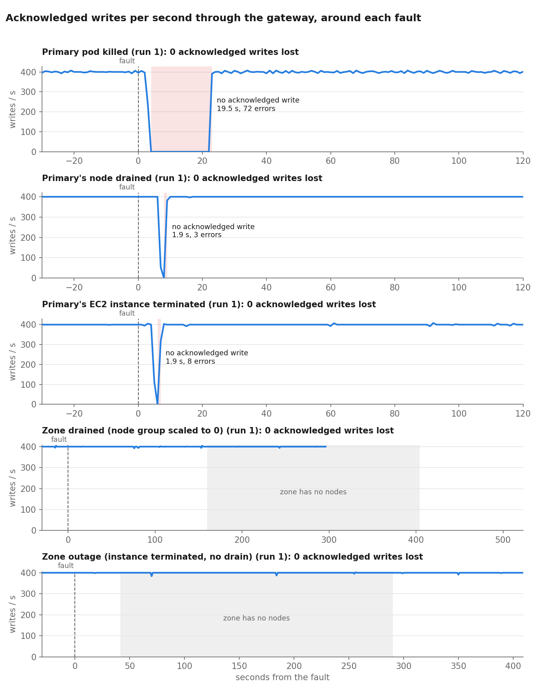
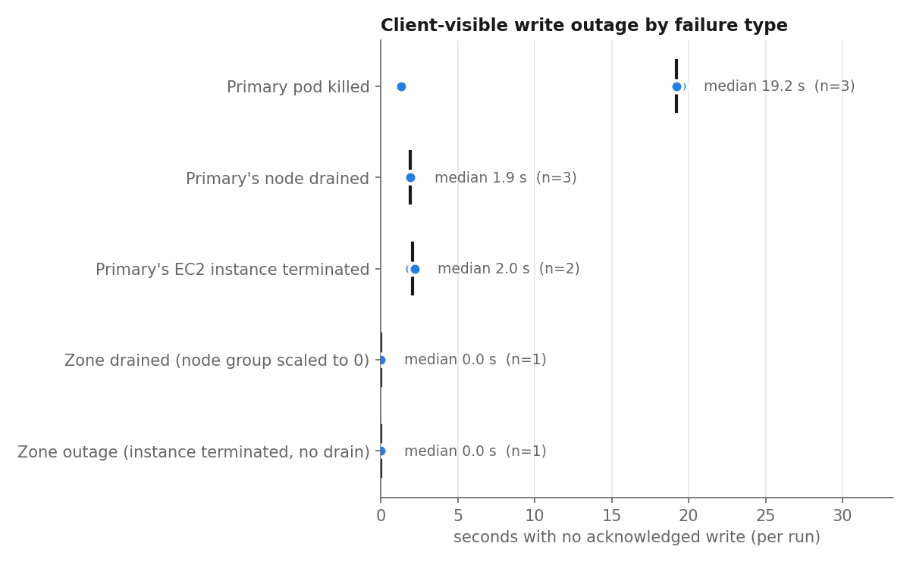
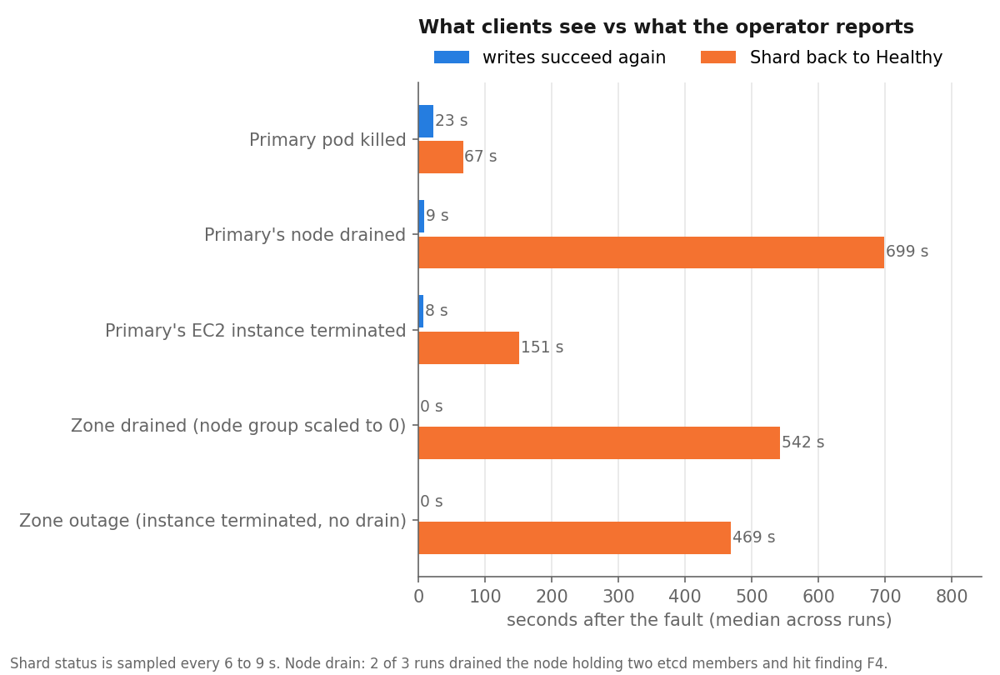
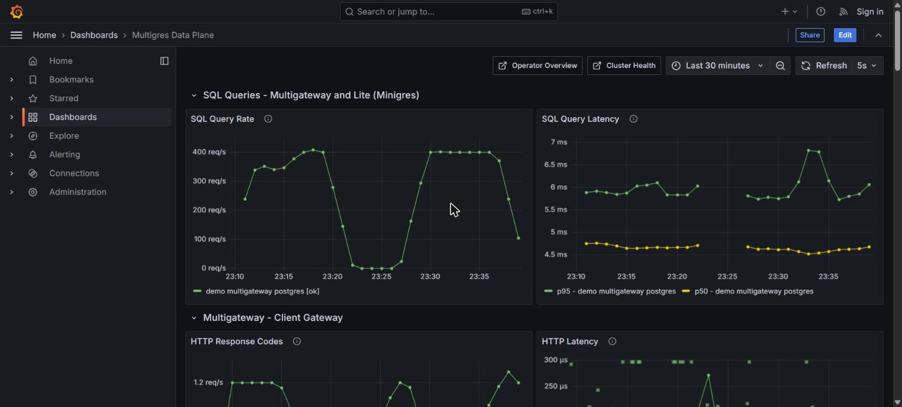
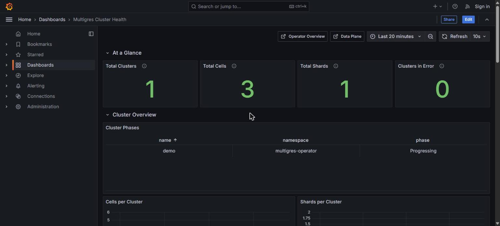

# Multigres on Amazon EKS across three zones: failure drill results

Multigres (operator `current` build of 26 Nov 2026) was deployed across three availability zones on EKS and broken on purpose while an application wrote through its gateway: the primary's pod killed, its node drained and terminated, a zone drained, and a zone lost outright. Every write was logged and every acknowledged write checked afterwards.

## Summary

| | |
|---|---|
| **Acknowledged writes lost** | **0** of 1,515,719, across 10 drills, including losing a whole zone together with 2 of the 3 global etcd members |
| **Writes during a zone outage** | uninterrupted: no gap longer than 0.08 s between acknowledged writes |
| **Failover after a node or instance loss** | about 2 s with no successful write |
| **Failover after a primary pod crash** | 19.5 s and 19.2 s in two runs, 1.3 s in the third: two detection paths, about 5x apart |
| **Commit latency**, every commit confirmed in a second zone | p50 5 ms, p99 7 to 12 ms |

Four problems found, each with evidence, a workaround and a suggested fix ([findings](findings/README.md)):

| | Problem | Impact on an EKS user |
|---|---|---|
| **F1** | Pool pods set no `fsGroup`; on EBS the pooler cannot write to its new volume | the default cluster never starts |
| **F2** | Fixing the spec does not roll the broken pods, because a rollout waits for a primary that cannot exist | a manual pod delete is needed to recover |
| **F3** | The managed global etcd is not spread across zones by default; 2 of 3 members landed in one zone | losing that zone loses etcd quorum |
| **F4** | With F3, draining that zone's node deadlocks on the etcd PodDisruptionBudget | node patching, node group upgrades and scale-in stall in that zone |

And four gaps in the operator's own monitoring during the zone outage, the most important being that **no alert covers the global etcd** and that **the top-level dashboard showed "Progressing" and "0 clusters in error"** while a zone and the etcd quorum were gone ([O1 to O4](findings/O-monitoring-gaps/README.md)).

None of these appear on a single-machine kind cluster: they need real zonal volumes, real zones and real maintenance events.

## What was tested

```mermaid
flowchart LR
  subgraph az1["apse2-az1"]
    p1["pooler (Postgres)"]
    w["writer: 8 connections, ~400 writes/s"]
    m["Prometheus, Grafana (zone outage drill)"]
  end
  subgraph az2["apse2-az2"]
    p2["pooler (Postgres)"]
    e1["etcd member"]
  end
  subgraph az3["apse2-az3"]
    p3["pooler (Postgres)"]
    e0["etcd member"]
    e2["etcd member"]
  end
  w -->|through the gateway Service| p2
  p2 -. "every commit confirmed in a second zone" .- p1
  p2 -. .- p3
```

*Placement at the start of the zone outage drill. The primary moved between zones across runs; the two etcd members in `apse2-az3` did not (F3).*

- **AWS:** free-plan account, `ap-southeast-2`, one `m7i-flex.large` node (2 vCPU, 8 GiB) per zone, gp3 volumes through the EBS CSI driver.
- **Multigres:** 3 cells pinned by zone ID, one pooler per cell, durability `MULTI_CELL_AT_LEAST_2`, operator-managed 3-member etcd for the global topology, pgBackRest backups to S3 through IRSA.
- **Workload:** 8 connections inserting 50 rows a second each through the gateway, 2-second statement timeout. Every attempt is logged; afterwards every acknowledged write is checked by key.
- **Each drill:** fault at 60 seconds into a 6-minute run (10 minutes for the zone outage), proof that the fault happened, logs of every component, then verification.

Full detail: [methodology](methodology.md), [scenarios](scenarios.md), [validation](validation.md), [failure modes](failure-modes.md), [observability](observability.md), [reproduce](reproduce.md).

## Results

### Per drill

| Drill | Runs | Acknowledged writes lost | Longest time with no acknowledged write | Errors clients saw | New primary |
|---|---|---|---|---|---|
| Primary pod killed (`--force`) | 3 | 0 | 19.5 s, 19.2 s, 1.3 s | 72 each in the two slow runs, all 2-second timeouts; none in the fast one | another zone, every run |
| Primary's node drained | 3 | 0 | 1.9 s, 2.0 s, 1.9 s | 0 to 3 dropped connections | another zone, every run |
| Primary's EC2 instance terminated | 2 | 0 | 1.9 s, 2.2 s | 8 and 12 (refused connections, dropped connections, timeouts) | another zone, every run |
| Zone drained (node group scaled to 0), no etcd member in it | 1 | 0 | none over 0.05 s | none | unchanged (primary elsewhere) |
| **Zone outage** (instance terminated, no drain), 2 of 3 etcd members in it | 1 | **0** | **none over 0.08 s** | 1 refused, 1 dropped connection | unchanged (primary elsewhere) |

Every row is in [`results/runs.csv`](results/runs.csv); each run's raw events, logs and proof are in `results/<drill>-<run>/`.





### What clients see vs what the operator reports

Writes recover in seconds; the Shard's status takes minutes to return to `Healthy`, and much longer where F4 applies. A dashboard or runbook keyed on Shard status alone will overstate short incidents and keep paging after clients have recovered.



### Two things an application team should know

- **A timed-out write may have committed.** In two runs, every write that timed out or lost its connection mid-commit had in fact committed (3 of 3, and 8 of 8); in others none had. No write that returned an error ever committed. Retries need to be idempotent.
- **A primary crash can take about 20 seconds to detect.** In two of three pod kills, multiorch promoted a new primary 22 seconds after the kill, through its `LeaderUnreachableByCohort` and `LeaderQuorumWritesStalled` path; in the third, it promoted after 4.2 seconds through `LeaderUnhealthy`. Promotion itself took under a second each time. Three runs are too few to give odds; the two paths are visible in the multiorch logs of each run.

### The zone outage, on the operator's own dashboards

The operator's Prometheus, alert rules and Grafana dashboards ran in `apse2-az1` during the zone outage. Their Data Plane dashboard shows the query rate holding at about 400 a second through the outage (from 23:27 local time), with p95 latency peaking near 6.8 ms when the zone returned:



Their alerts `MultigresCellGatewayUnavailable` (critical) and `MultigresClusterReconcileErrors` fired. Meanwhile the Cluster Health dashboard reported the cluster as `Progressing`, with 0 clusters in error, and no alert covered the global etcd, which was down to 1 of 3 members:



## Documented EKS patterns

| Check | Result |
|---|---|
| Install the operator with server-side apply | **pass**: Ready in 32 s. The README quick start still pins v0.11.0; the latest release is v0.11.1 |
| Cells pinned by zone ID, with their volumes | **pass**: every pooler and its gp3 volume in its cell's zone |
| Backups to S3 through IRSA (`docs/backup-restore.md`) | **pass**: full backup and WAL archive in S3 with no static keys |
| A cluster on EKS 1.30+ | needs a default StorageClass (EKS creates none); the admission webhook rejects the cluster with a clear message |
| Default pool settings on EBS | **fail**: F1 |
| Gateway through an Elastic IP; online EBS volume growth | not tested in this round |

## Before running Multigres on EKS

Each item is backed by a result above.

1. **Set `fsGroup: 999` on every pool** before creating the cluster (F1). If a cluster was created without it, delete the pool pods once after fixing the spec (F2).
2. **Spread the global etcd across zones at creation** with `globalTopoServer.placement.topologySpreadConstraints` on `topology.kubernetes.io/zone` (F3). It cannot be fixed later without recreating members, because each member's volume is tied to its zone.
3. **Check where the etcd members landed** before any node maintenance. If two share a zone, draining that zone's node will stall (F4).
4. **Run more than one node per zone** if pods must be able to move during maintenance. With one node per zone, a drained zone's pooler and etcd member wait for the zone's node to return.
5. **Mark a gp3 StorageClass as the default**, with `WaitForFirstConsumer`.
6. **Add an alert on the global etcd** (members ready, or `etcd_server_has_leader`), and do not read "Progressing" on the Cluster Health dashboard as "nothing is wrong" (O1, O2).
7. **Lower the metrics export interval** to 10 to 15 seconds if dashboards must show failovers (O3).
8. **Make application writes idempotent.** A write that timed out may have committed.
9. **Expect up to about 20 seconds without writes** after a primary crash, and set client timeouts and retries for that.

## Limits

- **One node per zone, small instances** (2 vCPU, `m7i-flex`, whose full CPU is not guaranteed all the time), one region, about 400 writes a second. Times are relative; production instances and load will differ.
- **Few runs per drill:** 3, 3, 2, 1 and 1. Enough to show behaviour and find problems, not to give percentiles. The pod-kill result is bimodal and needs more runs to characterise.
- **One Multigres build** (operator `current` of 26 Nov 2026, image digest in [`results/_versions/`](results/_versions/)). Multigres is alpha; results hold for this version.
- **The writer runs inside the cluster** and connects to the gateway Service; clients outside the cluster, behind a load balancer, were not tested.
- **Shard status is sampled every 6 to 9 seconds**; client-side times come from every write and are exact.
- **The operator's monitoring stack** ran only during the zone outage drill.
- Not tested: restores from the S3 backups, operator upgrades on a live cluster, EKS node group version upgrades, Karpenter, a load balancer in front of the gateway, more than one shard.

## Reproduce

From a new AWS free-plan account to teardown in about four hours: [reproduce.md](reproduce.md).
