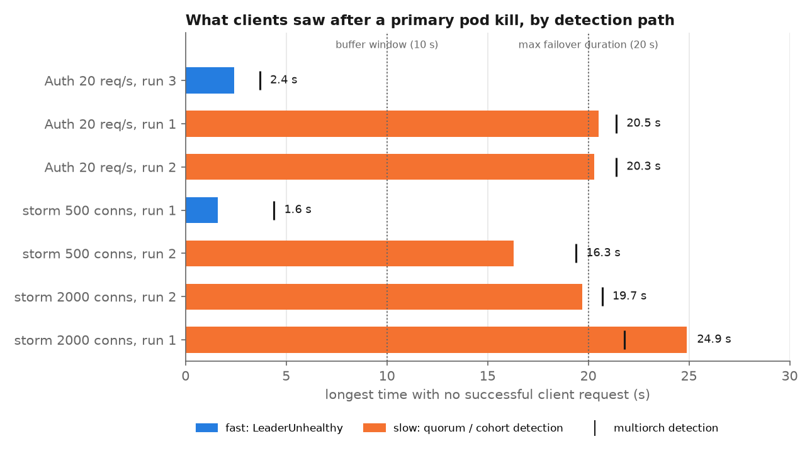
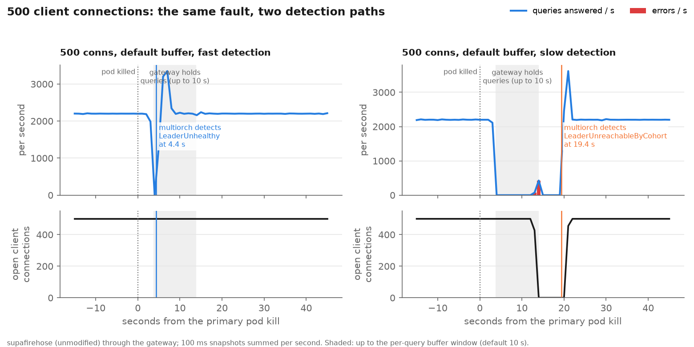
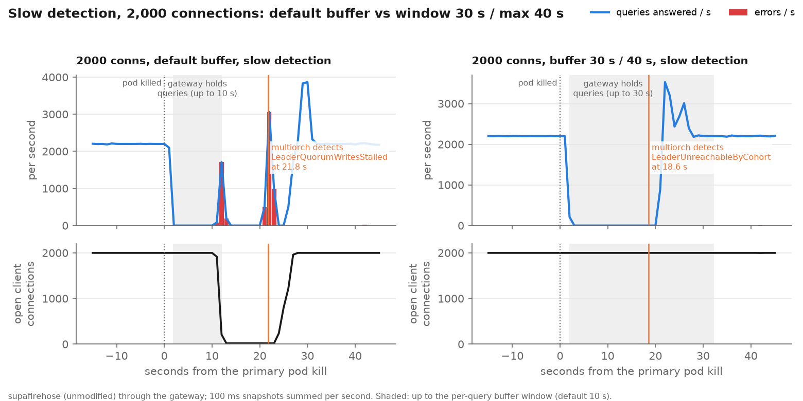
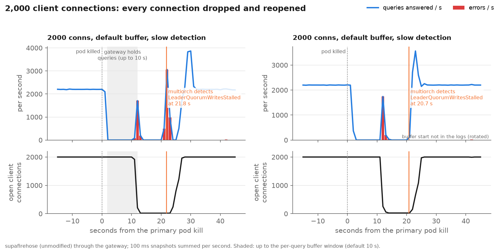
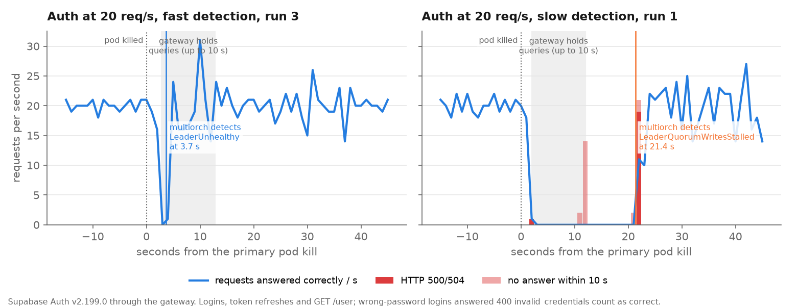

# What a Supabase-style app sees when the Multigres primary dies

The [failure drills](../failure-drill/failure-drill.md) measured what a single, well-behaved writer sees during a failover. This part asks what an application in production sees. It uses two workloads shaped like a Supabase project:

1. **Reconnect storm.** [supafirehose](https://github.com/multigres/supafirehose), Multigres's own load tool, unmodified, holds 500 or 2,000 client connections through the gateway (2,000 reads/s, 200 writes/s).
2. **Auth logins.** [Supabase Auth](https://github.com/supabase/auth) (GoTrue v2.199.0) uses the gateway as its database. Simulated users sign in, refresh tokens and fetch their profile at 20 requests/s. 5% deliberately use a wrong password, as a control.

In each run the primary's pod is killed 60 seconds in, while the drill writer from `failure-drill/` keeps checking that no acknowledged write is lost. Same cluster as the failure drills: EKS, three zones, one pooler per zone, `MULTI_CELL_AT_LEAST_2`, operator build `c9ef95f1`.

## Summary

| Measure | Result |
|---|---|
| **Acknowledged writes lost** | **0** of 1,714,155 across 14 runs (11 with a fault, 3 baselines) |
| **Supabase Auth through the gateway** | works unmodified: all 78 of its migrations ran, 200 users signed up, 0 errors without a fault |
| **Clients, when multiorch detects the dead primary fast** (default buffer, 2 of 7 runs, 3.7–4.4 s) | **0 errors**. The gateway held queries and replayed them. Longest gap 1.6 s (storm), 2.4 s (Auth) |
| **Clients, when detection takes the slow path** (default buffer, 5 of 7 runs, 19.4–21.8 s) | **16–25 s with no successful request**. Every held query failed after 10 s, and nearly every client connection dropped and reconnected at once |
| **Supabase Auth during a slow failover** | about 20 s of HTTP 500 ("Database error querying schema") and requests hanging until the client's 10 s timeout |
| **Valid users told "wrong password"** | **0**. Every credential lookup that failed during failover was answered "temporarily unavailable, retry" (SQLSTATE 57P03) |
| **Gateway under 2,000 reconnecting clients** | stayed up. Peak 127 MiB of its 256 MiB limit, 0.37 CPU cores, no restarts |
| **The fix, verified: buffer window 30 s, max failover 40 s** (4 more runs, all on the slow path) | held queries replayed, **0 buffer timeouts**. Client errors fell from 500–6,533 per run to **2–11** in 3 of 4 runs. Connections stayed open (1,998 of 2,000, against 18–24 before). Clients still wait about 20 s for the new primary |

**What decides whether a failover is invisible or a 20-second outage is which detection path multiorch takes.** On the fast path (`LeaderUnhealthy`), a new primary arrives while the gateway still holds the queries. On the slow path (`LeaderQuorumWritesStalled` or `LeaderUnreachableByCohort`), detection takes longer than both of the gateway's buffer limits. Those limits are the defaults: `--buffer-window` is 10 s and `--buffer-max-failover-duration` is 20 s.

## Findings

| | Finding | Impact |
|---|---|---|
| **P1** | The gateway's default buffer limits (10 s per request, 20 s per failover) are shorter than multiorch's slow detection path (18.6–22.4 s here) | a failover clients would not have noticed becomes 16–25 s of errors for every client. Raising the limits to 30 s / 40 s fixes it (verified) |
| **P2** | When the held queries time out, every client drops its connection at once and reconnects (500 of 500; 1,982 and 1,976 of 2,000) | a reconnect storm against the gateway exactly while there is no primary |
| **P3** | During the slow path Supabase Auth returns HTTP 500, or hangs until the client gives up | sign-in, token refresh and `GET /user` fail for about 20 s. The errors are generic 500s, not "retry later" |
| **P4** | During a slow failover the gateway logs every failed query. That rotated away the start of the failover in its container log in 2 of 7 runs | the evidence needed to debug a failover is gone unless gateway logs are shipped off the node |

Each is described below with the evidence. One negative result, also worth knowing: the pod kill did **not** reproduce [multigres#1728](https://github.com/multigres/multigres/issues/1728) (valid logins rejected with `password authentication failed`). That issue needs a Postgres crash with the pooler still alive. A pod kill takes both down, and the gateway answered every failed credential lookup with the retryable 57P03.

### P1. The buffer limits are shorter than the slow detection path

The gateway holds a query while a failover is in progress and replays it on the new primary. It gives up on a query after `--buffer-window` (default 10 s) and on the whole failover after `--buffer-max-failover-duration` (default 20 s). The operator exposes both as `multigateway.buffer.window` and `multigateway.buffer.maxFailoverDuration` (in `cells[].spec` or a CellTemplate). Its API comment describes buffering as being for "planned failovers", and sizes it from them: about 8.3 s on average on a test cluster, where 20 s "masked all of them". The runs here show the buffer also decides the client experience of an unplanned failover, and that the slow detection path (19.4–21.8 s) is longer than either limit.

| Run | Detection (s after kill) | Buffering began | Buffering ended, reason | Queries replayed | Held queries that timed out (MTB02) | Client errors | Longest gap for clients |
|---|---|---|---|---|---|---|---|
| storm 500, run 1 | `LeaderUnhealthy` 4.4 | 3.8 s | 5.1 s, new primary | 508 | 0 | **0** | 1.6 s |
| Auth, run 3 | `LeaderUnhealthy` 3.7 | 2.8 s | 4.5 s, new primary | 24 | 0 | **0** | 2.4 s |
| storm 500, run 2 | `LeaderUnreachableByCohort` 19.4 | 3.9 s | 20.0 s, new primary | 540 | 510 | 500 | 16.3 s |
| storm 2000, run 1 | `LeaderQuorumWritesStalled` 21.8 | 1.9 s | 21.9 s, **max failover duration exceeded** | 2,022 | 1,998 | 6,533 | 24.9 s |
| storm 2000, run 2 | `LeaderQuorumWritesStalled` 20.7 | not in log (P4) | 21.5 s, new primary | 2,016 | not in log | 2,000 | 19.7 s |
| Auth, run 1 | `LeaderQuorumWritesStalled` 21.4 | 2.0 s | 22.1 s, **max failover duration exceeded** | 60 | 0 | 40 | 20.5 s |
| Auth, run 2 | `LeaderQuorumWritesStalled` 21.4 | not in log (P4) | not in log | – | – | 28 | 20.3 s |

*Times are seconds after the pod kill, from the gateways' and multiorch's own logs. "Queries replayed" and "timed out" are summed over the three gateways.*

On the slow path, two things happen:
- **At 10 s** every held query fails with `failover buffer timeout (SQLSTATE MTB02)`. That's the error spike at about 14 s in run 2 above.
- **At 20 s** the gateway stops buffering altogether. In two runs that was 0.1–0.6 s after multiorch detected the failure, before the new primary was serving. The queries it then released met no primary yet, which is the second error spike in the 2,000-connection chart.

Across the 11 pod kills here and the 3 in `failure-drill/`, the slow path fired in 11 of 14. These runs do not show what selects the path.

#### The fix, measured: window 30 s, max failover 40 s

The same pod kill, run 4 more times with `multigateway.buffer.window: 30s` and `maxFailoverDuration: 40s` set on all three cells. Nothing else changed. Every one of the 4 took the slow path (18.6–22.4 s), so each is a direct comparison.

| | Default buffer (10 s / 20 s), slow path | Buffer 30 s / 40 s, slow path |
|---|---|---|
| Runs | 3 storm (500, 2,000, 2,000) | 4 storm (500 ×3, 2,000) |
| Detection | 19.4–21.8 s | 18.6–22.4 s |
| Buffering ended | new primary, or **max failover duration exceeded** | **new primary**, every run |
| Held queries that timed out (MTB02) | 510 and 1,998, in the runs where the log has it | **0** |
| Client errors per run | 500, 2,000, 6,533 | **2, 6, 11**, and 267 in one run (below) |
| Lowest open connections | 0 of 500; 18 and 24 of 2,000 | 500, 495, 318 of 500; **1,998 of 2,000** |
| Longest time with no successful request | 16.3–24.9 s | 19.5–21.1 s |
| Back to full query rate | 20–28 s | 22–23 s |
| Gateway peak memory | 55–127 MiB | 43–115 MiB |

The gap stays about 20 s, because the new primary still takes that long. What changes is what clients see during it: **they wait instead of failing**, then every held query (579 to 2,065 per run) runs on the new primary.

In the one run with 267 errors, all of them came in the first 2 seconds after the kill, before buffering had started: queries already running on the dying primary, failing with `57P03` or `statement timed out before backend cleanup could be confirmed`. That's a separate, smaller effect, not the buffer giving up. Those 182 clients reconnected, and their new connections were held until the new primary arrived.

**What this means**, in order of how much it changes:
- **Today:** set `multigateway.buffer.window` and `maxFailoverDuration` above the worst detection plus promotion time. 30 s and 40 s worked here.
- **In the operator:** raise the defaults it writes, or document them for unplanned failover.
- **In multiorch:** make the slow detection path faster. That's the only way to shorten the 20 s itself.

### P2. Every client reconnects at the same moment

| Connections | Run | Open connections, lowest after the kill | All open again after | Back to full query rate after | Client errors | Gateway peak memory (limit 256 MiB) | Gateway peak CPU |
|---|---|---|---|---|---|---|---|
| 500 | 1 (fast) | 500 | (never dropped) | 6 s | 0 | 58 MiB | 0.31 cores |
| 500 | 2 (slow) | **0** | 21.3 s | 20 s | 500 | 55 MiB | 0.31 cores |
| 2,000 | 1 (slow) | **18** | 27.4 s | 28 s | 6,533 | 127 MiB | 0.33 cores |
| 2,000 | 2 (slow) | **24** | 25.1 s | 22 s | 2,000 | 121 MiB | 0.37 cores |
| 2,000 | baseline, no fault | 2,000 | – | – | 0 | 81 MiB | 0.30 cores |

supafirehose closes a connection after an error and reconnects after 100 ms, which is how many pools and serverless clients behave. Once the held queries time out together, all of them reconnect together. While there's no primary, the gateway can't look up their credentials. In storm 2,000 run 1 it rejected 4,713 connection attempts, every one with `57P03 database is temporarily unavailable; please retry`, which is the right answer. It stayed up through this with memory well under its limit. The cost lands on clients: thousands of errors where a longer buffer would have replayed every query once.

### P3. Supabase Auth: generic 500s for about 20 seconds

| Run | Detection | Requests answered correctly | HTTP 500 / 504 | No answer within 10 s | Valid logins told "invalid credentials" | Wrong passwords answered correctly | Longest gap | Back to normal after |
|---|---|---|---|---|---|---|---|---|
| baseline, no fault | – | 4,200 of 4,200 | 0 | 0 | 0 | 216 of 216 | 0 s | – |
| run 3 | fast, 3.7 s | 7,761 of 7,761 | 0 | 0 | 0 | 290 of 290 | 2.4 s | 5.1 s |
| run 1 | slow, 21.4 s | 7,391 of 7,431 | 20 | 20 | 0 | 239 of 239 | 20.5 s | 22.5 s |
| run 2 | slow, 21.4 s | 7,402 of 7,430 | 2 | 26 | 0 | 237 of 237 | 20.3 s | 22.5 s |

What users would see:
- **On a slow failover:** HTTP 500 `unexpected_failure`, with messages like `Database error querying schema`, `Database error granting user` and `Unexpected failure, please check server logs`. Some requests hang until the client's 10 s timeout, and one 504 `request_timeout`.
- **On a fast one:** nothing at all.

Auth's 500 has no retry hint, so a client library can't tell a database failover from a bug. That's Auth's side, not Multigres's. It is, though, what a Supabase user sees for about 20 seconds on the slow path, and P1 would remove it.

Auth itself needed nothing special. The roles a Supabase Postgres image creates (`supabase_auth_admin`, `anon`, `authenticated`, `service_role`, in [`sql/auth-roles.sql`](sql/auth-roles.sql)) were enough, and Auth ran its 78 migrations through the gateway on start-up. Login latency without a fault was 161 ms at p50, 481 ms at p99. That's mostly bcrypt, with Auth at 0.9 of a core.

### P4. The gateway's own logs lose the start of the failover

During a slow failover each gateway logs every failed query and every failed connection. In storm 2,000 run 1 each gateway wrote 4.4–4.9 MB, 95% of it these per-query lines. `kubectl logs` shows only the current log file, which the kubelet rotates at 10 MiB by default, so in 2 of 7 runs (storm 2,000 run 2 and Auth run 2) the `failover detected, starting buffering` line was already gone when the run collected logs, a few minutes later. Anyone relying on `kubectl logs` to investigate a failover after the fact would see the end of it but not the start. Shipping gateway logs off the node (the operator's OTel collector already runs) or logging failed queries at a lower level per failover would keep the evidence.

## Durability

| Runs | Acknowledged writes | Lost | Ambiguous (error after sending) | of those, committed |
|---|---|---|---|---|
| 7 with a pod kill, default buffer | 959,472 | **0** | 51 | 11 |
| 4 with a pod kill, buffer 30 s / 40 s | 539,364 | **0** | 28 | 19 |
| 3 baselines | 215,319 | **0** | 0 | 0 |

The drill writer is the same checker as in `failure-drill/`. It sends 8 connections × 50 inserts a second through the gateway, and afterwards checks every acknowledged key. "Ambiguous" writes got an error after the statement was sent, so the client can't know whether they committed. Some did, which is why applications need idempotent retries. No write that failed before sending was ever committed.

## What to check before running Multigres behind Supabase-style clients

- **Measure your failover detection time, not only the promotion time.** Here the same fault took 3.7 s or 21.8 s to detect.
- **Set the gateway buffer above that worst case** (`multigateway.buffer.window` and `maxFailoverDuration`; 30 s and 40 s worked here). Otherwise the buffer turns a slow failover into an error storm.
- **Give clients backoff with jitter on reconnect.** A pool that reconnects after a fixed 100 ms sends every connection back at the same moment.
- **Treat SQLSTATE 57P03 and MTB02 as retryable** in drivers and pools, and keep retries idempotent: 30 writes that errored had in fact committed.
- **Ship gateway logs off the node** before you need them (P4).
- **Size gateway memory from connections.** It was 45 MiB at 500 idle connections, 81 MiB at 2,000, and 127 MiB during a 2,000-client reconnect storm.

## Limits

- **Small sample:** 11 fault runs, all of the same kind (primary pod kill). Enough to show that both behaviours exist, what each costs and that the buffer change fixes the error storm, not how often each path happens.
- **Small nodes and one client pod:** nodes have 2 vCPU. All load came from one client pod in `apse2-az1` (peak 0.65 cores), so client CPU didn't limit the results. Auth ran as one replica.
- **The client decides much of the storm:** supafirehose's fixed 100 ms reconnect makes the storm as sharp as it can be. Clients with backoff would spread it out, but would still see the same 16–25 s with no primary.
- **The buffer fix was measured on the storm only,** not on Auth, and only on the slow path. A longer window also means a client waits longer before getting an error when a failover really does fail. A larger window doesn't help an application with its own shorter timeout.
- **Logs:** in two runs the start of buffering was rotated out of the gateway logs (P4). Those cells are marked "not in log". Every other number comes from client-side events, which are complete.

## Files

| Path | What it is |
|---|---|
| [`README.md`](README.md) | how a run works, what is measured and how, validation, how to reproduce |
| `results/<run>/` | one folder per run: client events, supafirehose metrics, Auth events, gateway and multiorch logs, resources |
| `results/runs.csv`, `results/series/`, `results/errors/` | the tables, per-second series and every distinct client error behind this page |
| `results/charts/` | the charts above, drawn by `analysis/plot.py` from the CSVs |
